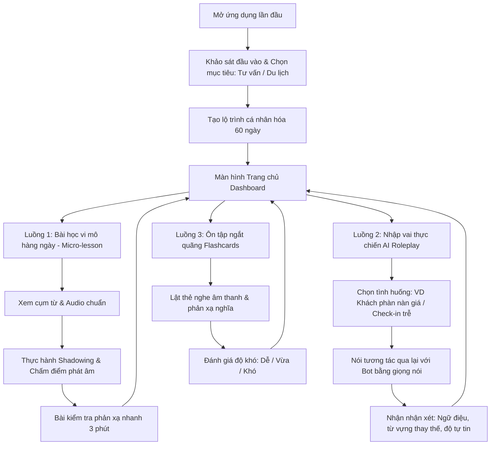
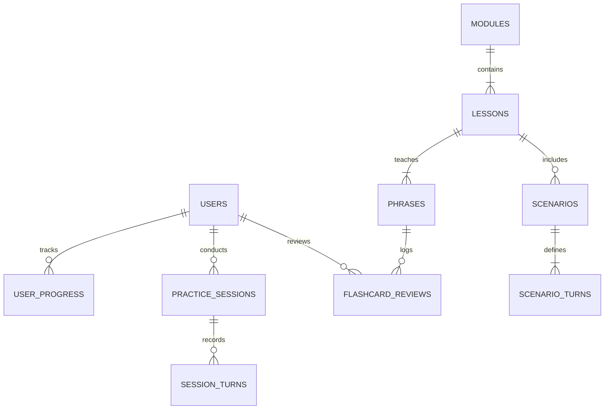

# TÀI LIỆU YÊU CẦU SẢN PHẨM (PRD - PRODUCT REQUIREMENTS DOCUMENT)

**Tên dự án:** Consult & Travel Speak (CT-Speak)  
**Sứ mệnh:** Xóa bỏ rào cản mất gốc, giúp chuyên viên tư vấn tự tin giao tiếp tiếng Anh trong công việc và du lịch quốc tế trong 60 ngày.  
**Phiên bản:** 1.0.0  
**Tác giả:** Product Team  
**Đối tượng áp dụng:** Đội ngũ phát triển (Dev, QA, UI/UX, Data Engineer, Content/Curriculum Designer).

---

## 1. BÀI TOÁN (PROBLEM STATEMENT)

### 1.1. Bối cảnh & Thực trạng
Người đi làm trong mảng **tư vấn** (tư vấn tài chính, bảo hiểm, bất động sản, dịch vụ khách hàng, giáo dục...) thường xuyên gặp khách hàng, đối tác nước ngoài hoặc tài liệu tiếng Anh cơ bản. Tuy nhiên, nhóm người học "mất gốc" gặp các rào cản nghiêm trọng:
- **Tâm lý sợ sai & ngại nói:** Nỗi sợ phát âm sai, ngữ pháp sai trước mặt người khác dẫn đến việc im lặng, né tránh giao tiếp khi gặp người nước ngoài.
- **Tính thực dụng & ngữ cảnh không khớp:** Các chương trình tiếng Anh đại trà thường tập trung quá nhiều vào ngữ pháp hàn lâm (thì, câu bị động, đảo ngữ...) hoặc từ vựng học thuật (IELTS/TOEIC) không thể ứng dụng ngay vào cuộc gọi tư vấn, email trao đổi hay chuyến du lịch nước ngoài.
- **Rào cản thời gian:** Lịch làm việc theo ca hoặc biến động khiến họ không thể theo học các lớp học truyền thống cố định giờ.
- **Tình huống thực tế khi du lịch:** Khi ra nước ngoài, họ lúng túng ở các điểm chạm sinh tồn cốt lõi: làm thủ tục hải quan sân bay, nhận phòng khách sạn, gọi món ăn, hỏi đường, giải quyết hành lý thất lạc hoặc sự cố thanh toán.

### 1.2. Mục tiêu sản phẩm (Product Objectives)
- Cung cấp ứng dụng luyện nói phản xạ tương tác (Interactive Speech & AI Roleplay) không phán xét, cá nhân hóa theo 2 trụ cột: **Tư vấn công việc (Workplace Consulting)** và **Du lịch sinh tồn (Travel Survival)**.
- Xây dựng phản xạ theo phương pháp "Chunking" (học theo cụm từ mẫu dùng ngay) và "Shadowing" (nhại âm chuẩn) thay vì phân tích ngữ pháp phức tạp.
- Đưa người học từ trình độ CEFR A0 (mất gốc hoàn toàn) lên tự tin ở mức CEFR A2 (giao tiếp chủ động trong các tình huống quen thuộc) sau 60 ngày (15 phút/ngày).

---

## 2. NGƯỜI DÙNG (TARGET USERS & PERSONAS)

### 2.1. Phân khúc người dùng mục tiêu
- **Nhân khẩu học:** 23 – 42 tuổi, đang làm việc tại các vị trí tư vấn (Sales Consultant, Customer Advisor, Relationship Manager, v.v.).
- **Trình độ tiếng Anh:** Mất gốc (nhớ bập bõm bảng chữ cái, vài từ đơn lẻ như *hello, thank you, price*, không thể ghép thành câu hoàn chỉnh và phát âm sai trọng âm).
- **Hành vi & Động lực:** 
  - Muốn nâng cao thu nhập, mở rộng tệp khách hàng nước ngoài tại công ty.
  - Thích đi du lịch tự túc nước ngoài (Thái Lan, Singapore, Nhật Bản, châu Âu...) nhưng sợ bị kẹt, bị lừa hoặc không biết xoay xở khi phát sinh sự cố.
  - Sợ bị chê cười khi nói tiếng Anh trước người lạ; cần môi trường "luyện tập riêng tư, an toàn".

### 2.2. Chân dung người dùng điển hình (User Persona)

| Thuộc tính | Chi tiết |
| :--- | :--- |
| **Họ và tên** | Nguyễn Minh Tuấn (30 tuổi) |
| **Nghề nghiệp** | Chuyên viên tư vấn giải pháp tài chính & bảo hiểm |
| **Hiện trạng** | Học tiếng Anh 10 năm trước thời phổ thông nhưng quên sạch; phát âm "nuốt âm đuôi", không nghe kịp người bản xứ nói. |
| **Nỗi đau (Pain Points)** | Từng đánh mất cơ hội tiếp đón một khách hàng doanh nhân nước ngoài do không dám nhấc máy nói chuyện; đi du lịch Bangkok bị tính nhầm hóa đơn mà không biết cách phản hồi. |
| **Mục tiêu (Goals)** | 1. Nói lưu loát 30 mẫu câu tư vấn (chào đón, xin thông tin, hẹn lịch, báo giá, xin lỗi & cảm ơn).<br>2. Tự tin làm thủ tục hải quan, đặt phòng, gọi món khi du lịch mà không cần dùng Google Translate từng chữ. |
| **Thói quen** | Rảnh 15-20 phút vào giờ nghỉ trưa hoặc trước khi đi ngủ; sử dụng smartphone hệ điều hành iOS/Android. |

---

## 3. PHẠM VI (SCOPE)

### 3.1. Nằm trong phạm vi (In-Scope - MVP V1.0)
1. **Lộ trình học 2 trụ cột (Two-Pillar Curriculum):**
   - **Trụ cột 1: Tư vấn công việc (Workplace Consulting):**
     - Chào hỏi & mở đầu cuộc hội thoại chuyên nghiệp (Greeting & Ice-breaking).
     - Khai thác nhu cầu & lắng nghe chủ động (Active listening & Needs discovery).
     - Giới thiệu quyền lợi & báo giá dịch vụ (Presenting options & Price quote).
     - Xử lý câu hỏi thường gặp & khéo léo từ chối/hẹn lịch lại (Handling objections & Follow-up).
     - Kết thúc cuộc gọi/buổi gặp mặt & viết tin nhắn xác nhận lịch (Wrap-up & Confirmation).
   - **Trụ cột 2: Du lịch ứng dụng (Travel Survival):**
     - Sân bay & Hải quan (Airport & Immigration/Customs).
     - Khách sạn & Lưu trú (Check-in, Check-out, yêu cầu dịch vụ phòng).
     - Nhà hàng & Cà phê (Gọi món, thanh toán, dị ứng thực phẩm).
     - Di chuyển & Hỏi đường (Taxi, tàu điện ngầm, lạc đường).
     - Xử lý tình huống khẩn cấp (Mất đồ, đổi lịch, trễ chuyến, gặp bác sĩ).
2. **Hệ thống luyện tập cốt lõi (Core Practice Mechanics):**
   - Luyện nghe - nhại âm (Shadowing) kèm chấm điểm phát âm bằng AI (Đánh giá mức độ khớp âm: 0 - 100%).
   - Kịch bản hội thoại nhập vai AI (AI Roleplay Simulator): Đóng vai nhân viên tư vấn trò chuyện với khách hàng ảo hoặc đóng vai khách du lịch nói chuyện với nhân viên hải quan.
   - Thẻ ghi nhớ thông minh (Spaced Repetition Flashcards): Ôn tập cụm từ then chốt tự động lặp lại theo chu kỳ trí nhớ.
3. **Quản trị người dùng & Tiến độ:**
   - Đăng nhập/Đăng ký tài khoản (Phone OTP/Google/Email).
   - Theo dõi chuỗi ngày học liên tục (Streak), huy hiệu tiến bộ (Badges), điểm tự tin (Confidence Index).

### 3.2. Không nằm trong phạm vi (Out-of-Scope - Các phiên bản sau)
- Không dạy ngữ pháp học thuật, cấu trúc phân tích câu phức tạp, không dạy viết luận văn.
- Không luyện thi chứng chỉ quốc tế (IELTS, TOEFL, TOEIC 4 kỹ năng).
- Không cung cấp lớp học trực tiếp 1-1 với giáo viên người thật (Live Tutor) trong phiên bản V1.0 (nhằm giảm tối đa chi phí và loại bỏ hoàn toàn áp lực tâm lý cho người học mất gốc).
- Không hỗ trợ offline hoàn toàn (cần kết nối internet để xử lý nhận diện giọng nói và phản hồi AI).

---

## 4. LUỒNG CHÍNH (KEY USER FLOWS)

### 4.1. Sơ đồ tổng thể các luồng người dùng



### 4.2. Chi tiết 4 luồng thao tác trọng yếu

#### Luồng 1: Khảo sát & Kích hoạt lộ trình (Onboarding Flow)
1. Người dùng mở app -> Chọn mức độ hiện tại: *"Mất gốc hoàn toàn"* hoặc *"Nhớ vài từ đơn lẻ"*.
2. Chọn ưu tiên mục tiêu:
   - Ưu tiên 1: Giao tiếp tư vấn khách hàng.
   - Ưu tiên 2: Đi du lịch nước ngoài trong 1-3 tháng tới.
3. Hệ thống tạo lộ trình học: Mỗi ngày 1 bài học 15 phút (gồm 3 cụm từ trọng tâm + 1 tình huống đàm thoại).

#### Luồng 2: Học bài học vi mô hàng ngày (Daily Micro-Lesson Flow)
1. **Bước 1 (Ghi nhận ngữ cảnh):** Xem một đoạn video/hoạt hình ngắn 20 giây mô tả tình huống (ví dụ: Khách hỏi *"Can you give me a discount?"*).
2. **Bước 2 (Giải mã cụm từ cốt lõi):** Giới thiệu mẫu câu phản xạ chuẩn: *"I understand your point, but this package includes..."*. Hiển thị phiên âm IPA, nghĩa tiếng Việt, và nút bấm nghe phát âm chậm từng từ.
3. **Bước 3 (Luyện nói nhại âm - Shadowing):** Người dùng giữ nút micro để đọc lại. Hệ thống hiển thị phổ âm thanh, bôi xanh các từ phát âm chuẩn, bôi cam/đỏ các từ nuốt âm hoặc sai trọng âm.
4. **Bước 4 (Phản xạ tức thì):** Hệ thống hỏi bằng âm thanh, người dùng có 5 giây để bấm nói trả lời mà không có phụ đề tiếng Anh trước mắt.

#### Luồng 3: Thực hành đàm thoại kịch bản AI (Interactive AI Roleplay Flow)
1. Người dùng chọn phòng thực hành: Ví dụ *"Tình huống: Đón khách quốc tế tại sảnh văn phòng"* hoặc *"Tình huống: Hải quan hỏi mục đích chuyến đi"*.
2. AI đóng vai (persona) phát ra lời thoại âm thanh tự nhiên: *"Good morning! I have an appointment with Mr. Tuấn at 10 AM."*
3. Người dùng trả lời bằng giọng nói (có sẵn 3 gợi ý từ khóa nếu bí ý tưởng).
4. AI tiếp nhận, phản hồi ngữ cảnh thực tế và kết thúc sau 4-6 lượt đối đáp (Turn-based conversation).
5. Màn hình tổng kết (Scorecard): Hiển thị điểm độ trôi chảy (Fluency), độ chính xác phát âm (Pronunciation), và gợi ý mẫu câu tự nhiên hơn (Better alternatives).

#### Luồng 4: Ôn tập trí nhớ ngắt quãng (Spaced Repetition Review Flow)
1. Hệ thống nhắc nhở thông báo (Push Notification): *"Có 5 cụm từ tư vấn cần ôn để không bị quên hôm nay!"*.
2. Thẻ lật: Nghe câu tiếng Anh -> Người dùng tự dịch thầm -> Chạm để xem nghĩa tiếng Việt và cách dùng.
3. Người dùng chọn 1 trong 3 mức độ nhớ: *Chưa thuộc (Hard - lặp lại sau 10 phút)*, *Tạm nhớ (Good - lặp lại sau 1 ngày)*, *Đã thành phản xạ (Easy - lặp lại sau 4 ngày)*.

---

## 5. DỮ LIỆU CẦN LƯU (DATA MODEL & MOCK DATABASE)

Để đảm bảo tính khả thi kỹ thuật cho đội ngũ Backend, hệ thống sử dụng cơ sở dữ liệu quan hệ chuẩn hóa (**PostgreSQL Engine**). Dưới đây là kiến trúc Schema thực tế kèm theo bộ dữ liệu giả lập (Seed Data) đầy đủ, chân thực cho cả 2 bối cảnh Tư vấn và Du lịch.

### 5.1. Sơ đồ quan hệ thực thể (ERD)



---

### 5.2. Kịch bản tạo bảng CSDL (PostgreSQL DDL)

```sql
-- 1. Bảng Người dùng (Users)
CREATE TABLE users (
    user_id SERIAL PRIMARY KEY,
    full_name VARCHAR(100) NOT NULL,
    email VARCHAR(150) UNIQUE NOT NULL,
    phone_number VARCHAR(20),
    current_level VARCHAR(30) DEFAULT 'A0_ZERO_BASE', -- A0_ZERO_BASE, A1_BEGINNER, A2_ELEMENTARY
    primary_goal VARCHAR(50) NOT NULL, -- CONSULTING, TRAVEL, BOTH
    job_title VARCHAR(100),
    streak_count INT DEFAULT 0,
    confidence_index INT DEFAULT 10, -- Thang điểm 0 - 100
    created_at TIMESTAMP WITH TIME ZONE DEFAULT CURRENT_TIMESTAMP,
    updated_at TIMESTAMP WITH TIME ZONE DEFAULT CURRENT_TIMESTAMP
);

-- 2. Bảng Mô-đun kiến thức (Modules: Workplace Consulting vs Travel Survival)
CREATE TABLE modules (
    module_id SERIAL PRIMARY KEY,
    category VARCHAR(50) NOT NULL, -- WORKPLACE_CONSULTING, TRAVEL_SURVIVAL
    title VARCHAR(150) NOT NULL,
    description TEXT,
    order_index INT NOT NULL,
    is_active BOOLEAN DEFAULT TRUE
);

-- 3. Bảng Bài học vi mô (Lessons)
CREATE TABLE lessons (
    lesson_id SERIAL PRIMARY KEY,
    module_id INT REFERENCES modules(module_id) ON DELETE CASCADE,
    title VARCHAR(150) NOT NULL,
    target_situation TEXT NOT NULL,
    estimated_minutes INT DEFAULT 15,
    order_index INT NOT NULL,
    created_at TIMESTAMP WITH TIME ZONE DEFAULT CURRENT_TIMESTAMP
);

-- 4. Bảng Mẫu câu & Từ vựng then chốt (Phrases)
CREATE TABLE phrases (
    phrase_id SERIAL PRIMARY KEY,
    lesson_id INT REFERENCES lessons(lesson_id) ON DELETE CASCADE,
    english_text TEXT NOT NULL,
    vietnamese_meaning TEXT NOT NULL,
    ipa_phonetic VARCHAR(255) NOT NULL,
    audio_sample_url VARCHAR(255) NOT NULL,
    context_note TEXT,
    difficulty_level VARCHAR(20) DEFAULT 'EASY' -- EASY, MEDIUM, ADVANCED
);

-- 5. Bảng Kịch bản đóng vai AI (Scenarios)
CREATE TABLE scenarios (
    scenario_id SERIAL PRIMARY KEY,
    lesson_id INT REFERENCES lessons(lesson_id) ON DELETE SET NULL,
    title VARCHAR(150) NOT NULL,
    ai_role_name VARCHAR(100) NOT NULL,       -- Ví dụ: 'Mr. David (Client)', 'Immigration Officer'
    user_role_name VARCHAR(100) NOT NULL,     -- Ví dụ: 'Financial Consultant', 'Tourist'
    context_briefing TEXT NOT NULL,
    initial_ai_greeting TEXT NOT NULL,
    difficulty_level VARCHAR(20) DEFAULT 'EASY'
);

-- 6. Bảng Kịch bản lượt thoại mẫu (Scenario Turns / Prompts)
CREATE TABLE scenario_turns (
    turn_id SERIAL PRIMARY KEY,
    scenario_id INT REFERENCES scenarios(scenario_id) ON DELETE CASCADE,
    step_order INT NOT NULL,
    expected_user_intent VARCHAR(150) NOT NULL,
    suggested_sample_phrases TEXT[], -- Gợi ý 3 cách nói từ dễ đến tự nhiên
    bot_reaction_rules TEXT
);

-- 7. Bảng Phiên thực hành & Báo cáo chấm điểm AI (Practice Sessions)
CREATE TABLE practice_sessions (
    session_id SERIAL PRIMARY KEY,
    user_id INT REFERENCES users(user_id) ON DELETE CASCADE,
    scenario_id INT REFERENCES scenarios(scenario_id),
    started_at TIMESTAMP WITH TIME ZONE DEFAULT CURRENT_TIMESTAMP,
    completed_at TIMESTAMP WITH TIME ZONE,
    fluency_score NUMERIC(5, 2),        -- 0.00 đến 100.00
    pronunciation_score NUMERIC(5, 2),  -- 0.00 đến 100.00
    ai_feedback_summary TEXT
);

-- 8. Bảng Lịch sử lượt nói chi tiết trong phiên (Session Turns)
CREATE TABLE session_turns (
    session_turn_id SERIAL PRIMARY KEY,
    session_id INT REFERENCES practice_sessions(session_id) ON DELETE CASCADE,
    turn_index INT NOT NULL,
    user_speech_transcript TEXT,
    detected_pronunciation_score NUMERIC(5,2),
    ai_response_text TEXT,
    created_at TIMESTAMP WITH TIME ZONE DEFAULT CURRENT_TIMESTAMP
);

-- 9. Bảng Ôn tập Thẻ nhớ ngắt quãng (Flashcard Reviews - Spaced Repetition)
CREATE TABLE flashcard_reviews (
    review_id SERIAL PRIMARY KEY,
    user_id INT REFERENCES users(user_id) ON DELETE CASCADE,
    phrase_id INT REFERENCES phrases(phrase_id) ON DELETE CASCADE,
    repetition_count INT DEFAULT 0,
    interval_days INT DEFAULT 1,
    easiness_factor NUMERIC(3, 2) DEFAULT 2.50,
    next_review_due TIMESTAMP WITH TIME ZONE NOT NULL,
    last_reviewed_at TIMESTAMP WITH TIME ZONE DEFAULT CURRENT_TIMESTAMP
);

-- 10. Bảng Theo dõi tiến độ học bài (User Progress)
CREATE TABLE user_progress (
    progress_id SERIAL PRIMARY KEY,
    user_id INT REFERENCES users(user_id) ON DELETE CASCADE,
    lesson_id INT REFERENCES lessons(lesson_id) ON DELETE CASCADE,
    status VARCHAR(30) DEFAULT 'IN_PROGRESS', -- NOT_STARTED, IN_PROGRESS, COMPLETED
    completion_percentage INT DEFAULT 0,
    highest_score NUMERIC(5, 2) DEFAULT 0,
    last_accessed_at TIMESTAMP WITH TIME ZONE DEFAULT CURRENT_TIMESTAMP,
    CONSTRAINT unique_user_lesson UNIQUE(user_id, lesson_id)
);
```

---

### 5.3. Dữ liệu giả lập thực tế (Mock / Seed Data)

Dưới đây là các câu lệnh `INSERT` chứa toàn bộ dữ liệu giả lập cho người dùng thật, các học phần tư vấn, du lịch, mẫu câu và hội thoại đóng vai.

```sql
-- ========================================================
-- 1. SEED DATA: BẢNG USERS (Người dùng mẫu)
-- ========================================================
INSERT INTO users (user_id, full_name, email, phone_number, current_level, primary_goal, job_title, streak_count, confidence_index) VALUES
(1, 'Nguyễn Minh Tuấn', 'tuan.nguyen@consulting-sample.vn', '0912345678', 'A0_ZERO_BASE', 'BOTH', 'Chuyên viên Tư vấn Tài chính', 5, 35),
(2, 'Trần Thu Trang', 'trang.tran@insurance-corp.vn', '0987654321', 'A0_ZERO_BASE', 'CONSULTING', 'Tư vấn viên Bảo hiểm', 12, 50),
(3, 'Lê Hoàng Nam', 'nam.le@realestate-hub.com', '0903112233', 'A1_BEGINNER', 'TRAVEL', 'Chuyên viên Môi giới BĐS', 3, 25);

-- ========================================================
-- 2. SEED DATA: BẢNG MODULES (2 Trụ cột cốt lõi)
-- ========================================================
INSERT INTO modules (module_id, category, title, description, order_index, is_active) VALUES
(1, 'WORKPLACE_CONSULTING', 'Giao tiếp Tư vấn & Khách hàng Cơ bản', 'Trang bị các mẫu câu thực chiến để chào đón khách, lắng nghe nhu cầu và xử lý tình huống tư vấn.', 1, TRUE),
(2, 'TRAVEL_SURVIVAL', 'Tiếng Anh Du lịch Quốc tế Sinh tồn', 'Mẫu câu và phản xạ khi làm thủ tục sân bay, khách sạn, nhà hàng và giải quyết tình huống phát sinh.', 2, TRUE);

-- ========================================================
-- 3. SEED DATA: BẢNG LESSONS (Bài học vi mô chi tiết)
-- ========================================================
INSERT INTO lessons (lesson_id, module_id, title, target_situation, estimated_minutes, order_index) VALUES
-- Thuộc Module Tư vấn (Module 1)
(101, 1, 'Chào đón khách & Mở đầu cuộc hẹn', 'Gặp đối tác/khách hàng quốc tế tại sảnh công ty hoặc qua Zoom meeting.', 15, 1),
(102, 1, 'Lắng nghe & Khai thác nhu cầu', 'Hỏi thăm mong muốn của khách hàng bằng những câu đơn giản, lịch thiệp.', 15, 2),
(103, 1, 'Báo giá & Giải thích gói dịch vụ', 'Trình bày mức giá và quyền lợi cơ bản mà không bị ấp úng.', 15, 3),
(104, 1, 'Xử lý khi khách chê đắt hoặc lưỡng lự', 'Các câu xoa dịu và đề xuất giải pháp thay thế linh hoạt.', 15, 4),

-- Thuộc Module Du lịch (Module 2)
(201, 2, 'Thủ tục Sân bay & Xuất nhập cảnh', 'Trả lời các câu hỏi phổ biến của nhân viên hải quan khi hạ cánh.', 15, 1),
(202, 2, 'Nhận phòng Khách sạn & Yêu cầu dịch vụ', 'Làm thủ tục Check-in, hỏi mật khẩu Wi-Fi, đổi phòng hoặc mượn đồ.', 15, 2),
(203, 2, 'Gọi món tại Nhà hàng & Thanh toán', 'Hỏi món đặc trưng, báo dị ứng món ăn, và yêu cầu xuất hóa đơn.', 15, 3),
(204, 2, 'Hỏi đường & Di chuyển công cộng', 'Hỏi trạm tàu điện ngầm, đón taxi và giải quyết khi bị lạc đường.', 15, 4);

-- ========================================================
-- 4. SEED DATA: BẢNG PHRASES (Mẫu câu thực chiến có phiên âm IPA)
-- ========================================================
INSERT INTO phrases (phrase_id, lesson_id, english_text, vietnamese_meaning, ipa_phonetic, audio_sample_url, context_note, difficulty_level) VALUES
-- Mẫu câu bài 101: Chào đón khách
(1001, 101, 'Good morning! Welcome to our office.', 'Chào buổi sáng! Chào mừng quý khách đến văn phòng chúng tôi.', '/ɡʊd ˈmɔː.nɪŋ! ˈwel.kəm tuː ɑːr ˈɒf.ɪs/', 'https://audio.ctspeak.app/p1001.mp3', 'Dùng khi đón khách tại cửa ra vào', 'EASY'),
(1002, 101, 'Did you have any trouble finding our place?', 'Quý khách tìm đường đến đây có khó khăn gì không ạ?', '/dɪd juː hæv ˈen.i ˈtrʌb.l̩ ˈfaɪn.dɪŋ ɑːr pleɪs/', 'https://audio.ctspeak.app/p1002.mp3', 'Câu chuyện phiếm mở đầu (Ice-breaker) tạo thiện cảm', 'MEDIUM'),
(1003, 101, 'Please take a seat. Can I get you some water or coffee?', 'Mời quý khách ngồi. Tôi có thể lấy chút nước hoặc cà phê cho quý khách không?', '/pliːz teɪk ə siːt. kæn aɪ ɡet juː sʌm ˈwɔː.tər ɔːr ˈkɒf.i/', 'https://audio.ctspeak.app/p1003.mp3', 'Hành vi lịch thiệp của nhân viên tư vấn', 'EASY'),

-- Mẫu câu bài 103: Báo giá & giải thích gói
(1004, 103, 'Our standard package starts at two hundred dollars per month.', 'Gói tiêu chuẩn của chúng tôi có giá khởi điểm từ 200 đô mỗi tháng.', '/ɑːr ˈstæn.dəd ˈpæk.ɪdʒ stɑːts æt tuː ˈhʌn.drəd ˈdɒl.əz pɜː mʌnθ/', 'https://audio.ctspeak.app/p1004.mp3', 'Cấu trúc thông báo mức giá cơ bản', 'MEDIUM'),
(1005, 103, 'This plan includes 24/7 customer support and free consultation.', 'Gói này đã bao gồm hỗ trợ khách hàng 24/7 và tư vấn miễn phí.', '/ðɪs plæn ɪnˈkluːdz ˈtwen.ti fɔː ˈsev.n̩ ˈkʌs.tə.mər səˈpɔːt ænd friː ˌkɒn.sʌlˈteɪ.ʃən/', 'https://audio.ctspeak.app/p1005.mp3', 'Nhấn mạnh quyền lợi đi kèm', 'MEDIUM'),

-- Mẫu câu bài 201: Hải quan & Sân bay
(2001, 201, 'I am here for a vacation for five days.', 'Tôi đến đây để du lịch nghỉ dưỡng trong 5 ngày.', '/aɪ æm hɪər fɔːr ə vəˈkeɪ.ʃən fɔː faɪv deɪz/', 'https://audio.ctspeak.app/p2001.mp3', 'Trả lời câu hỏi: What is the purpose of your visit?', 'EASY'),
(2002, 201, 'Here is my passport and return flight ticket.', 'Đây là hộ chiếu và vé máy bay khứ hồi của tôi.', '/hɪər ɪz maɪ ˈpɑːs.pɔːt ænd rɪˈtɜːn flaɪt ˈtɪk.ɪt/', 'https://audio.ctspeak.app/p2002.mp3', 'Xuất trình giấy tờ khi được yêu cầu', 'EASY'),

-- Mẫu câu bài 202: Nhận phòng Khách sạn
(2003, 202, 'I have a reservation under the name Nguyen Minh Tuan.', 'Tôi có đặt phòng trước dưới tên Nguyễn Minh Tuấn.', '/aɪ hæv ə ˌrez.əˈveɪ.ʃən ˈʌn.dər ðə neɪm .../', 'https://audio.ctspeak.app/p2003.mp3', 'Câu mở đầu kinh điển tại quầy lễ tân', 'EASY'),
(2004, 202, 'Could you please give me the Wi-Fi password?', 'Bạn có thể cho tôi xin mật khẩu Wi-Fi được không?', '/kʊd juː pliːz ɡɪv miː ðə ˈwaɪ.faɪ ˈpɑːs.wɜːd/', 'https://audio.ctspeak.app/p2004.mp3', 'Yêu cầu tiện ích cơ bản nhất', 'EASY');

-- ========================================================
-- 5. SEED DATA: BẢNG SCENARIOS (Kịch bản AI Roleplay)
-- ========================================================
INSERT INTO scenarios (scenario_id, lesson_id, title, ai_role_name, user_role_name, context_briefing, initial_ai_greeting, difficulty_level) VALUES
(501, 101, 'Đón tiếp đối tác nước ngoài tại sảnh công ty', 'Mr. Robert (Khách hàng Singapore)', 'Chuyên viên tư vấn', 'Khách hàng hẹn lúc 10h sáng để bàn về việc đăng ký dịch vụ. Bạn cần chào đón niềm nở và dẫn khách vào phòng họp.', 'Hello, good morning! I am Robert from Singapore. I have an appointment here today.', 'EASY'),
(502, 201, 'Vượt qua cửa kiểm soát nhập cảnh sân bay', 'Immigration Officer (Sĩ quan Hải quan)', 'Du khách tự túc', 'Bạn vừa đáp chuyến bay xuống sân bay Changi. Hải quan kiểm tra mục đích và nơi lưu trú của bạn.', 'Good day. May I see your passport and immigration form, please?', 'EASY'),
(503, 203, 'Gọi món và yêu cầu thanh toán tại nhà hàng', 'Sarah (Phục vụ bàn)', 'Thực khách', 'Bạn muốn hỏi về món ăn không cay và thanh toán bằng thẻ tín dụng.', 'Hi there! Are you ready to order, or do you need a few more minutes?', 'MEDIUM');

-- ========================================================
-- 6. SEED DATA: BẢNG SCENARIO_TURNS (Gợi ý phản xạ theo lượt)
-- ========================================================
INSERT INTO scenario_turns (turn_id, scenario_id, step_order, expected_user_intent, suggested_sample_phrases, bot_reaction_rules) VALUES
(1, 501, 1, 'Chào lại và xác nhận tên khách', ARRAY['Good morning Mr. Robert, nice to meet you!', 'Welcome to our office, Mr. Robert. Please follow me.'], 'Bot sẽ vui vẻ cảm ơn và hỏi thăm phòng họp ở đâu'),
(2, 501, 2, 'Mời nước và mời ngồi', ARRAY['Please take a seat here.', 'Would you like some tea or cold water?'], 'Bot sẽ chọn nước lọc và khen văn phòng đẹp'),
(3, 502, 1, 'Đưa hộ chiếu và chào lịch sự', ARRAY['Good morning officer, here is my passport.', 'Here you are, sir.'], 'Hải quan sẽ hỏi: How long will you stay here?'),
(4, 502, 2, 'Trả lời thời gian lưu trú và xuất trình vé về', ARRAY['I will stay for 4 days.', 'Just 4 days, here is my hotel booking and return ticket.'], 'Hải quan đóng dấu cộp và chúc chuyến đi vui vẻ');

-- ========================================================
-- 7. SEED DATA: BẢNG PRACTICE_SESSIONS & TURNS (Lịch sử luyện tập mẫu)
-- ========================================================
INSERT INTO practice_sessions (session_id, user_id, scenario_id, started_at, completed_at, fluency_score, pronunciation_score, ai_feedback_summary) VALUES
(9001, 1, 501, '2026-09-28 10:15:00+07', '2026-09-28 10:21:30+07', 78.50, 72.00, 'Phản xạ chào đón tự tin. Chú ý phát âm rõ âm đuôi /s/ trong từ "office" và nối âm trong cụm "nice to meet you".'),
(9002, 1, 502, '2026-09-29 14:00:00+07', '2026-09-29 14:05:12+07', 85.00, 80.50, 'Trả lời hải quan dứt khoát, đúng trọng tâm. Từ vựng "vacation" phát âm chuẩn xác.');

INSERT INTO session_turns (session_turn_id, session_id, turn_index, user_speech_transcript, detected_pronunciation_score, ai_response_text) VALUES
(1, 9001, 1, 'Good morning Mr. Robert! Welcome to our office, nice to meet you.', 75.0, 'Nice to meet you too! Your office is very modern and easy to find.'),
(2, 9001, 2, 'Thank you! Please take a seat. Can I get you some water?', 82.0, 'A glass of water would be great, thank you very much.');

-- ========================================================
-- 8. SEED DATA: BẢNG FLASHCARD_REVIEWS (Ôn tập Spaced Repetition)
-- ========================================================
INSERT INTO flashcard_reviews (review_id, user_id, phrase_id, repetition_count, interval_days, easiness_factor, next_review_due, last_reviewed_at) VALUES
(701, 1, 1001, 3, 4, 2.60, '2026-10-02 08:00:00+07', '2026-09-28 10:22:00+07'),
(702, 1, 1003, 1, 1, 2.50, '2026-09-30 08:00:00+07', '2026-09-29 14:06:00+07'),
(703, 1, 2001, 2, 2, 2.50, '2026-10-01 08:00:00+07', '2026-09-29 14:06:00+07');

-- ========================================================
-- 9. SEED DATA: BẢNG USER_PROGRESS (Tiến độ bài học)
-- ========================================================
INSERT INTO user_progress (progress_id, user_id, lesson_id, status, completion_percentage, highest_score, last_accessed_at) VALUES
(1, 1, 101, 'COMPLETED', 100, 85.50, '2026-09-28 10:22:00+07'),
(2, 1, 102, 'IN_PROGRESS', 40, 60.00, '2026-09-29 09:30:00+07'),
(3, 1, 201, 'COMPLETED', 100, 90.00, '2026-09-29 14:05:00+07'),
(4, 1, 202, 'NOT_STARTED', 0, 0.00, '2026-09-29 14:05:00+07');
```

---

## 6. TIÊU CHÍ HOÀN THÀNH (DEFINITION OF DONE - DOD & ACCEPTANCE CRITERIA)

### 6.1. Tiêu chí nghiệm thu tính năng (Functional Acceptance Criteria)

| Mã tiêu chí | Hạng mục | Điều kiện nghiệm thu cụ thể (Pass/Fail Criteria) |
| :--- | :--- | :--- |
| **AC-01** | Nhận diện giọng nói (STT) | Hệ thống nhận diện chính xác tiếng Anh của người Việt mất gốc (chấp nhận phát âm chưa hoàn hảo, nhận diện được từ khóa chính) với tỉ lệ nhận diện đúng từ khóa đạt **>= 85%**. |
| **AC-02** | Phản hồi đóng vai AI | AI Bot phản hồi theo ngữ cảnh kịch bản đã chọn trong thời gian **dưới 1.8 giây** kể từ khi người dùng nhả nút nói. |
| **AC-03** | Chấm điểm phát âm (Shadowing) | Trả về điểm chi tiết (0-100) và trực quan hóa từng từ (Xanh = Chuẩn, Vàng = Tương đối, Đỏ = Cần sửa) ngay sau khi kết thúc lượt nói không quá **1.0 giây**. |
| **AC-04** | Thuật toán ôn tập ngắt quãng | Khi người dùng chọn "Chưa thuộc", thẻ phải xuất hiện lại trong phiên học; chọn "Tạm nhớ" lùi hạn sang ngày hôm sau; chọn "Đã thuộc" tự động tính toán thời gian `next_review_due` chính xác theo thuật toán SM-2. |
| **AC-05** | Lưu trữ phiên & Khôi phục dữ liệu | Mọi kết quả bài học, điểm số, chuỗi ngày học (streak) phải được lưu trữ chuẩn xác vào CSDL PostgreSQL mà không phát sinh lỗi mất mát dữ liệu khi mất kết nối mạng đột ngột. |

### 6.2. Tiêu chí kỹ thuật & Phi chức năng (Non-Functional Acceptance Criteria)
1. **Hiệu năng (Performance):** 
   - Tốc độ tải màn hình bài học (Time-to-Interactive) **< 1.2 giây** trên mạng 4G tiêu chuẩn.
   - Luồng phát âm thanh mẫu (Audio Streaming) không bị giật, độ trễ bắt đầu phát âm thanh **< 300ms**.
2. **Khả năng tương thích (Compatibility):** 
   - Tương thích tốt trên trình duyệt di động (Safari iOS 15+, Chrome Android 10+) và Web Responsive.
   - Quyền truy cập Microphone được hướng dẫn rõ ràng, xử lý trường hợp người dùng từ chối cấp quyền với thông báo thân thiện.
3. **Bảo mật & Quyền riêng tư (Security & Privacy):**
   - File ghi âm giọng nói của người dùng được mã hóa đường truyền (HTTPS/WSS) và tự động xóa bỏ sau 30 ngày (chỉ giữ lại văn bản transcript và điểm số để bảo vệ quyền riêng tư).
   - Mật khẩu và thông tin định danh người dùng được mã hóa theo tiêu chuẩn an toàn (Argon2 hoặc Bcrypt).

### 6.3. Tiêu chí thành công của Người dùng (Product KPIs & User Success Metrics)

| Chỉ số (KPI) | Mục tiêu kỳ vọng (Target V1.0) | Phương pháp đo lường |
| :--- | :--- | :--- |
| **Tỉ lệ hoàn thành lộ trình 30 ngày đầu** | >= 65% số người dùng đăng ký | Đếm số người đạt trạng thái hoàn thành ít nhất 20 bài học trong tháng đầu. |
| **Chỉ số tự tin giao tiếp (Confidence Index)** | Tăng trung bình từ 15 điểm lên >= 70 điểm | Khảo sát tự đánh giá 5 câu hỏi định kỳ vào Ngày 1, Ngày 30 và Ngày 60. |
| **Tỷ lệ giữ chân người dùng (Retention Rate)** | D7 >= 45%, D30 >= 30% | Theo dõi lượt hoạt động hàng ngày (DAU/MAU). |
| **Khả năng phản xạ thực tế** | Giảm thời gian ngập ngừng từ 8s xuống < 2s | Đo lường độ trễ từ lúc Bot kết thúc câu hỏi đến lúc người dùng bắt đầu nói. |

---
*Tài liệu PRD này được phê duyệt làm tài liệu gốc để triển khai thiết kế giao diện (Figma), xây dựng API Backend và phát triển ứng dụng.*
